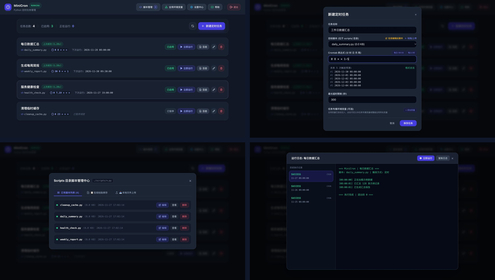

# MiniCron

MiniCron 是面向个人和小型服务器的 Python 定时任务控制台，适合日常签到、数据采集和运维脚本。通过浏览器配置 Cron、手动执行任务、管理脚本并查看运行日志。

## 界面预览



查看原图：[任务控制台](docs/images/dashboard.jpg) · [新建任务与 Cron 预演](docs/images/task-editor.jpg) · [脚本管理](docs/images/scripts.jpg) · [执行历史与日志](docs/images/execution-log.jpg)

## 功能亮点

- **轻量部署**：内置 Web 控制台和 SQLite，使用一个服务端口。
- **定时任务**：预演未来 5 次 Cron 触发时间，支持启停、手动运行和超时限制。
- **脚本管理**：在线编辑、粘贴或上传 Python 脚本。任务变量可覆盖同名全局环境变量。
- **日志与诊断**：查看实时输出和历史记录，可从日志窗口重新运行任务。检测到缺失模块时，可在界面安装依赖。
- **系统设置**：管理 Python 依赖、管理员密码和 Telegram 通知。自定义依赖在容器重建后按记录恢复。

## 项目目录

```text
MiniCron/
├── app/                 # Web 控制台、API、调度和任务执行
├── scripts/             # Python 任务脚本与内置 notify.py
├── data/                # SQLite 数据库与运行日志
├── docs/                # 使用指南、API、架构文档与截图
├── Dockerfile
├── docker-compose.yml
├── requirements.txt
└── start.sh
```

## 文档中心

- 任务、脚本、Cron 和通知配置：[使用指南](docs/help.md)
- 功能范围与需求：[产品需求](docs/PRD.md)
- 调度、执行与部署结构：[架构说明](docs/ARCHITECTURE.md)
- 接口与响应格式：[API 参考](docs/API_SPEC.md)

## 部署

在仓库根目录的 `.env` 中设置 `ADMIN_PASSWORD`（至少 12 个字符）和 `SECRET_KEY`（至少 32 个字符）。首次部署可运行以下命令生成随机值。升级已有实例时，请确认 `.env` 中两项都已设置。

```bash
if [ ! -e .env ]; then
  (
    set -e
    umask 077
    admin_password=$(openssl rand -hex 16)
    secret_key=$(openssl rand -hex 32)
    printf 'ADMIN_PASSWORD=%s\nSECRET_KEY=%s\n' "$admin_password" "$secret_key" > .env
  )
fi
```

### Docker Compose

```bash
docker compose up -d --build
```

用 `docker compose logs -f` 查看服务日志，用 `docker compose down` 停止服务。

### Docker 单容器

```bash
docker build -t minicron:latest .
docker run -d --name minicron --restart unless-stopped \
  --env-file .env -p 8000:8000 \
  -v "$PWD/data:/app/data" \
  -v "$PWD/scripts:/app/scripts" \
  minicron:latest
```

### 本地 Python（3.11+）

```bash
python3 -m venv .venv
source .venv/bin/activate
python -m pip install -r requirements.txt
python -m app.main
```

也可以在已激活的 Conda 环境中安装依赖，然后运行 `python -m app.main`。

## 访问控制台

浏览器打开 [http://localhost:8000](http://localhost:8000)。新实例使用 `.env` 中的 `ADMIN_PASSWORD` 登录。已通过界面修改密码的实例继续使用保存的密码。更换 `SECRET_KEY` 后需要重新登录。

部署后可登录控制台，确认任务列表能加载、Cron 能预演、历史日志能打开。Docker Compose 部署可用 `docker compose ps` 检查容器状态。

## Telegram 通知与代理

在「设置中心 → 通知与代理」填写 Telegram Bot Token 和任务 Chat ID。

- **任务通知**支持仅脚本主动通知、仅失败、每次执行和关闭。脚本可用 `from notify import send`，再调用 `send(title, content)` 发送自定义消息。仅脚本主动通知模式下，普通成功任务保持静默，异常会触发兜底告警。
- **安全通知**可为登录失败、登录成功和密码修改单独配置开关。安全 Chat ID 留空时使用任务 Chat ID。
- **连接方式**支持直连、HTTP 或 SOCKS5 正向代理，以及自定义反向代理地址。用「测试任务通道」和「测试安全通道」分别验证连通性。

Bot Token、Chat ID 和通知策略的配置详见 [使用指南](docs/help.md)。

## 安全部署

- 将 `.env`、运行数据和私人脚本保存在部署环境中。为每个实例设置独立的签名密钥。
- 仅需内网访问时，可使用私有网络。通过公网访问时，将应用端口绑定到 `127.0.0.1`，由反向代理提供 HTTPS。

## 版本历史

- **v2.0.0** · 显式配置部署凭据，修复会话刷新、Cron 调度、重复执行和超时处理。
- **v1.2.0** · 内置帮助、日志窗口快捷重跑，以及 SSE 日志和 Docker 构建改进。
- **v1.1.0** · 独立安全告警、脚本自定义通知和双通道测试。
- **v1.0.0** · 首个正式版本。

完整记录见 [更新日志](CHANGELOG.md)。
